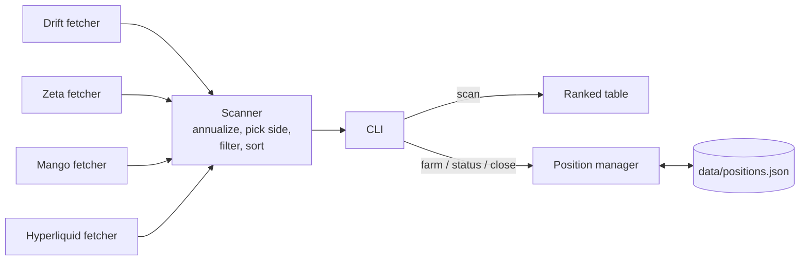

# Funding Rate Farmer

A TypeScript CLI that pulls perpetual-futures funding rates from four venues (Drift, Zeta, Mango and Hyperliquid), converts them to annualized APR, and ranks which side of which market currently earns funding. Positions are **paper-only**: the tool records simulated entries in a local JSON file and never places real orders.

## What is funding-rate farming?

Perpetual futures have no expiry, so exchanges keep the perp price close to spot with periodic **funding payments** between longs and shorts:

- **Positive funding rate:** longs pay shorts, so a short position earns.
- **Negative funding rate:** shorts pay longs, so a long position earns.

Funding-rate farming means holding the side that receives these payments. Because venues use different rates and intervals, comparing them requires normalizing to a common unit; this project uses annualized APR.

## Features

- **Multi-venue scan:** fetches funding rates from Drift, Zeta, Mango and Hyperliquid concurrently. A failing venue logs a warning and is skipped, so it does not abort the scan.
- **APR normalization:** `APR = rate × (24 / interval_hours) × 365`. Every venue integration currently uses a 1-hour interval.
- **Side selection:** for each market, recommends the side that receives funding and reports the absolute APR.
- **Ranking and filtering:** sorts opportunities by APR (highest first) and drops anything below a minimum APR threshold.
- **Paper positions:** `farm` records a simulated position in the top-ranked opportunity; `status` lists positions; `close` removes one. State is kept in `data/positions.json`.
- **Validated configuration:** environment variables are parsed with Zod. The process exits with a list of problems if a value is invalid.
- **Library exports:** `src/index.ts` re-exports the types, config, APR helpers, scanner, position manager and per-venue fetchers for use from other code.

## How it works



### Venue integrations

Each fetcher returns a list of `{ venue, marketSymbol, rate, intervalHours, fetchedAt }` records.

| Venue | Primary source | Fallback | Markets |
|---|---|---|---|
| Drift | `@drift-labs/sdk` `DriftClient` over the Solana RPC, reading `amm.fundingRate` (divided by 1e6) | `GET {DRIFT_API_URL}/markets`, if set | Fixed list of 14 symbols (SOL, BTC, ETH, APT, ARB, DOGE, BNB, OP, SUI, TIA, WIF, JUP, RENDER, PYTH) |
| Zeta | `@zetamarkets/sdk` `CrossClient`, reading `fundingRate` per asset | `GET {ZETA_API_URL}/markets`, if set | Fixed list of 10 symbols |
| Mango | REST: `GET https://api.mango.markets/v3/perp-markets` | `@blockworks-foundation/mango-client` over the Solana RPC (`longFunding - shortFunding`, labelled `PERP_<index>`) | Fixed list of 9 symbols for the REST path |
| Hyperliquid | REST: `POST {HYPERLIQUID_API_URL}/info` with `{"type":"metaAndAssetCtxs"}` | none | Every market in the returned universe, labelled `<NAME>-PERP` |

The Drift and Zeta REST fallbacks expect the configured endpoint to return a JSON array of `{ symbol, fundingRate }`. That is a shape defined by this project, not a documented venue API, so you would need to point them at your own service or adapter.

### Key files

| File | Responsibility |
|---|---|
| `src/cli.ts` | Commander-based CLI: `scan`, `farm`, `status`, `close` |
| `src/scanner.ts` | Fetches all venues, converts rates to opportunities, filters and sorts, prints the table |
| `src/apr.ts` | `annualizeFundingRate`, `earningSide`, and formatting helpers |
| `src/positions.ts` | Paper position store backed by `data/positions.json` |
| `src/config.ts` | Loads `.env` with dotenv and validates it with Zod |
| `src/types.ts` | `Venue`, `FundingRate`, `FarmingOpportunity`, `Position`, `PerpMarket` |
| `src/fetchers/*.ts` | One fetcher per venue |
| `src/index.ts` | Public library exports |

## Requirements

- Node.js 20 or newer (`engines` in `package.json`)
- npm
- A Solana RPC endpoint for the Drift and Zeta SDK paths and the Mango SDK fallback. The public mainnet endpoint is the default; a dedicated RPC provider is more reliable.

No wallet or API key is needed. Hyperliquid's info endpoint is public.

## Installation

```bash
git clone <this-repo-url>
cd funding-rate-farmer
npm install
cp .env.example .env   # then edit as needed
```

## Configuration

Settings are read from environment variables (or a `.env` file) and validated in `src/config.ts`.

| Variable | Default | Description |
|---|---|---|
| `HELIOS_RPC_URL` | `https://api.mainnet-beta.solana.com` | Solana RPC URL used by the Drift, Zeta and Mango SDK paths. Must be a valid URL. (The name is spelled `HELIOS` in the code, not `HELIUS`.) |
| `SOLANA_WALLET_JSON` | empty | Path to a Solana keypair file. Validated but **not used anywhere yet**; reserved for live trading, which is not implemented. |
| `DRIFT_API_URL` | empty | Base URL for the Drift REST fallback. If empty, the fallback is skipped. |
| `ZETA_API_URL` | empty | Base URL for the Zeta REST fallback. If empty, the fallback is skipped. |
| `HYPERLIQUID_API_URL` | `https://api.hyperliquid.xyz` | Hyperliquid API base URL. |
| `MIN_APR_PERCENT` | `20` | Default minimum APR (in percent) for `scan` and `farm`. Must be positive. |
| `SIMULATION_ONLY` | `true` | `true` or `1` enables simulation mode. Setting it to anything else only changes log labels (see [Status](#status-and-limitations)); orders are never sent. |

The sample `.env.example` contains placeholder values for `HELIOS_RPC_URL` and `SOLANA_WALLET_JSON`. Replace them or remove those lines to use the defaults.

## Usage

Run the TypeScript sources directly with `tsx` through the npm scripts:

| Script | Runs |
|---|---|
| `npm run scan` | `tsx src/cli.ts scan` |
| `npm run farm` | `tsx src/cli.ts farm` |
| `npm run status` | `tsx src/cli.ts status` |
| `npm run dev -- <command> [options]` | `tsx src/cli.ts` with any command and flags |
| `npm run build` | Compile to `dist/` with `tsc` |
| `npm start -- <command> [options]` | `node dist/cli.js` (after building) |
| `npm run clean` | Delete `dist/` |

Pass flags through `npm run dev --`. Running the CLI with no command prints help, and `--version` prints `0.1.0`.

### `scan`: rank current opportunities

```bash
npm run scan                       # uses MIN_APR_PERCENT
npm run dev -- scan --min-apr 50   # only show >= 50% APR
```

| Option | Default | Description |
|---|---|---|
| `-m, --min-apr <percent>` | `MIN_APR_PERCENT` | Minimum APR filter |

Prints a table with rank, venue, market, recommended side, APR, funding interval and a confidence column.

### `farm`: open a paper position in the top opportunity

```bash
npm run farm                                     # $1000 position
npm run dev -- farm --size 5000 --min-apr 30
```

| Option | Default | Description |
|---|---|---|
| `-s, --size <usd>` | `1000` | Position size in USD |
| `-m, --min-apr <percent>` | `MIN_APR_PERCENT` | Minimum APR filter |

Runs a scan, takes the highest-APR result, and appends it to `data/positions.json` (the directory is created on first use, relative to the current working directory).

### `status`: list paper positions

```bash
npm run status
```

### `close`: remove a paper position

```bash
npm run dev -- close pos_1712345678901_ab12cd
```

The argument is matched as a **prefix** of the position ID, and the first match is closed. The `status` table shows only the first 8 characters of each ID, and these are the same for every position (for example `pos_1712`). Open `data/positions.json` to get the full ID before closing.

## Risk and safety notes

- **This tool does not trade.** Nothing in the code signs or sends transactions. "Positions" are local JSON records.
- **Funding rates are not a yield guarantee.** They change every interval and can flip sign. An instantaneous rate annualized to a large APR may last only a few hours.
- **Directional exposure.** Holding one side of a perp exposes you to price moves, which can be much larger than the funding collected. Leverage adds liquidation risk. This tool does not hedge positions or model these risks.
- **Venue risk.** Smart contract, oracle, and counterparty risk apply to every venue. Some venues listed here may no longer operate (see below).
- **Not financial advice.** This is an educational and portfolio project.

## Project structure

```
funding-rate-farmer/
├── src/
│   ├── cli.ts             # CLI entry point
│   ├── index.ts           # Library exports
│   ├── config.ts          # Env loading and validation
│   ├── types.ts           # Shared types
│   ├── apr.ts             # APR math and formatting
│   ├── scanner.ts         # Multi-venue scan and ranking
│   ├── positions.ts       # Paper position store
│   └── fetchers/
│       ├── index.ts
│       ├── drift.ts
│       ├── zeta.ts
│       ├── mango.ts
│       └── hyperliquid.ts
├── data/                  # Created at runtime (positions.json)
├── .env.example
├── package.json
└── tsconfig.json
```

## Status and limitations

Version `0.1.0`. Experimental, with no automated tests.

**Simulation only**
- Live execution is not implemented. With `SIMULATION_ONLY=false`, `farm` prints `[LIVE]`, says live execution is not implemented, and records the same paper position.
- Entry prices come from a hard-coded placeholder table in `src/cli.ts`. Any symbol not in that table gets `100`. No mark prices are fetched (`markPrice` is always `0`).
- Unrealized PnL is not calculated, so `close` reports `N/A`.
- The confidence score is a fixed `0.7` for every opportunity.
- Each opportunity is a single-venue, single-side position. The tool does not build delta-neutral or cross-venue hedged pairs.

**Venues to verify**

The integrations were written against SDKs and endpoints as they existed at the time, and have not been re-checked since. Before relying on any venue, verify that:

- **Mango Markets** is still operating. Mango Markets reportedly wound down its v4 perps in 2025. The code also targets Mango **v3** (the `mango-client` v3 package, the v3 program ID, and the `api.mango.markets/v3` endpoint), and its market list includes delisted assets such as FTT and SRM. Expect this fetcher to return nothing.
- **Zeta Markets** still offers the same SDK interface (`CrossClient`, `getCross`, `fundingRate`) and markets.
- **Drift**: the SDK path matches markets by a `symbol` field and assumes 1e6 funding-rate precision. Both should be checked against the current `@drift-labs/sdk` perp market account layout.
- **Hyperliquid**: the `metaAndAssetCtxs` request is the simplest integration and the most likely to still work, but the response format is still worth confirming.

All funding intervals are hard-coded to 1 hour. If a venue uses a different interval, its APR will be misstated.

## License

No license file yet. All rights reserved.
