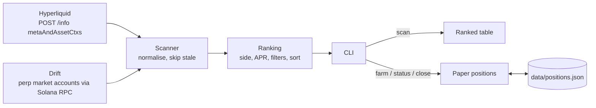

# Funding Rate Farmer

A TypeScript CLI that reads perpetual-futures funding rates from **Hyperliquid** and **Drift**, normalises them to annualised APR, ranks which side of which market currently receives funding, and lets you **paper-trade** that side with real mark prices and PnL.

It is read-only: it uses public APIs and plain Solana RPC reads, needs no API key or wallet, and never signs or sends a transaction.

## What is funding-rate farming?

Perpetual futures have no expiry, so exchanges keep the perp price close to spot with periodic **funding payments** between longs and shorts:

- **Positive funding rate:** longs pay shorts, so a short position earns.
- **Negative funding rate:** shorts pay longs, so a long position earns.

Funding-rate farming means holding the side that receives these payments. Venues quote rates per interval, so this project converts everything to a simple annualised APR:

```
APR = rate_per_interval × (24 / interval_hours) × 365
```

## Features

- **Two live venues.** Hyperliquid via its public info API; Drift by decoding its perp market accounts straight from Solana RPC.
- **Normalisation.** Every rate is converted to a fraction of notional per interval with one sign convention (positive = longs pay), then annualised.
- **Ranking.** Opportunities are sorted by APR earned (ties broken by open interest) and filtered by minimum APR and minimum open interest.
- **Staleness guard.** Drift markets whose last funding update is older than three funding periods are skipped and reported, so a paused market cannot top the ranking with an old rate.
- **Paper trading with real prices.** `farm` records a position at the scanned mark price and sizes it in base units. `status` and `close` re-fetch the live mark price and report price PnL plus estimated funding.
- **Close by ID prefix.** Any unique prefix of a position ID works; ambiguous or unknown prefixes fail with a clear message.
- **Tested.** Vitest suite for APR maths, sign conventions, venue parsing (including a fixture captured from the live Hyperliquid API), ranking, PnL, the position store and config.

## How it works



### Venue integrations

| Venue | Source | Rate | Interval | Mark price | Open interest |
|---|---|---|---|---|---|
| Hyperliquid | `POST {HYPERLIQUID_API_URL}/info` with `{"type":"metaAndAssetCtxs"}`; `universe[i]` pairs with asset context `i` | `funding` (decimal per hour) | 1 h | `markPx` | `openInterest × markPx` |
| Drift v2 | `getMultipleAccounts` on the perp market PDAs for every market in the SDK's `MainnetPerpMarkets`, decoded with the Drift IDL; symbol from the on-chain `name` | `amm.lastFundingRate / 1e9 ÷ (amm.lastFundingOracleTwap / 1e6)` | `amm.fundingPeriod` (3600 s) | `amm.historicalOracleData.lastOraclePrice / 1e6` | `amm.baseAssetAmountLong / 1e9 × price` |

Delisted Hyperliquid markets and inactive, reduce-only or delisted Drift markets are skipped. A venue that fails is reported and the scan continues with the others.

### Key files

| File | Responsibility |
|---|---|
| `src/cli.ts` | Commander CLI: `scan`, `farm`, `status`, `close` |
| `src/fetchers/hyperliquid.ts` | Hyperliquid request and response parsing |
| `src/fetchers/drift.ts` | Drift account fetch, decoding and normalisation |
| `src/scanner.ts` | Runs the venue fetchers concurrently; mark-price lookup |
| `src/ranking.ts` | Earning side, APR, filters and sort order |
| `src/apr.ts` | Annualisation and sign convention |
| `src/positions.ts` | Paper position store, ID-prefix resolution, PnL |
| `src/display.ts` | Console tables |
| `src/config.ts` | `.env` loading and Zod validation |
| `src/index.ts` | Library exports |
| `test/` | Vitest suite and a captured Hyperliquid response fixture |

## Requirements

- Node.js 20 or newer
- Network access to `api.hyperliquid.xyz` and a Solana mainnet RPC endpoint. The public `https://api.mainnet-beta.solana.com` is the default and is enough for the two batched account reads Drift needs.

## Installation

```bash
git clone <this-repo-url>
cd funding-rate-farmer
npm ci
cp .env.example .env   # optional; every setting has a default
```

## Configuration

Settings come from environment variables or a `.env` file. Empty values fall back to the default.

| Variable | Default | Description |
|---|---|---|
| `HELIUS_RPC_URL` | `https://api.mainnet-beta.solana.com` | Solana RPC used to read Drift market accounts. Any mainnet RPC URL works (Helius or otherwise). |
| `HELIOS_RPC_URL` | unset | **Deprecated** misspelling, still accepted if `HELIUS_RPC_URL` is unset; prints a warning. |
| `HYPERLIQUID_API_URL` | `https://api.hyperliquid.xyz` | Hyperliquid API base URL. |
| `MIN_APR_PERCENT` | `20` | Default minimum APR filter for `scan` and `farm`, in percent. |
| `MIN_OPEN_INTEREST_USD` | `100000` | Default minimum open interest filter, in USD. Markets that do not report OI are kept. |
| `POSITIONS_FILE` | `data/positions.json` | Paper position store, relative to the working directory. `data/` is git-ignored. |

## Usage

| Script | Runs |
|---|---|
| `npm run scan` / `farm` / `status` | `tsx src/cli.ts <command>` |
| `npm run dev -- <command> [options]` | `tsx src/cli.ts` with any command and flags |
| `npm run build` | Compile to `dist/` |
| `npm start -- <command> [options]` | `node dist/cli.js` (after building) |
| `npm test` | Run the Vitest suite |
| `npm run typecheck` | Type-check sources and tests |

### `scan`: rank current opportunities

```bash
npm run scan
npm run dev -- scan --min-apr 50 --min-oi 1000000 --limit 10
npm run dev -- scan --venue hyperliquid
```

| Option | Default | Description |
|---|---|---|
| `-m, --min-apr <percent>` | `MIN_APR_PERCENT` | Minimum APR earned |
| `--min-oi <usd>` | `MIN_OPEN_INTEREST_USD` | Minimum open interest |
| `-n, --limit <rows>` | `20` | Rows to print |
| `--venue <venue>` | all | `hyperliquid` or `drift` |

Sample output (live run, 3 Nov 2026, abbreviated):

```
Funding Rate Farmer  v0.2.0  (paper trading only)

Fetching funding rates...
  HYPERLIQUID  179 markets
               note: skipped 56 delisted markets
  DRIFT        0 markets
               note: skipped 47 markets with stale funding data (newest update 2026-04-01T18:00:49.000Z)
               note: skipped 38 inactive/delisted markets

12 opportunities with APR >= 20% and open interest >= $100,000

Rank  Venue        Market          Side   APR (earned)  Rate/interval   Mark price     Open interest
----------------------------------------------------------------------------------------------------
   1  HYPERLIQUID  HMSTR-PERP      short       572.97%      0.0654%/1h     $0.0001350         $1.64M
   2  HYPERLIQUID  CASHCAT-PERP    short       118.49%      0.0135%/1h        $0.1034        $22.63M
   3  HYPERLIQUID  BLUR-PERP       long        112.26%     -0.0128%/1h      $0.007359        $674.6K
   4  HYPERLIQUID  LAYER-PERP      long         87.17%     -0.0100%/1h       $0.05674        $288.7K
   5  HYPERLIQUID  XPL-PERP        long         81.23%     -0.0093%/1h       $0.06386        $51.38M
```

### `farm`: open a paper position

```bash
npm run farm                                             # $1000 in the top-ranked opportunity
npm run dev -- farm --size 2500 --min-apr 0 --market BTC-PERP
```

| Option | Default | Description |
|---|---|---|
| `-s, --size <usd>` | `1000` | Notional in USD; base size = notional / mark price |
| `-m, --min-apr <percent>` | `MIN_APR_PERCENT` | Minimum APR |
| `--min-oi <usd>` | `MIN_OPEN_INTEREST_USD` | Minimum open interest |
| `--market <symbol>` | top-ranked | Choose a market that passes the filters |
| `--venue <venue>` | all | Restrict to one venue |

```
Opened paper position:
  ID:        cf6cbf92
  Market:    HYPERLIQUID BTC-PERP
  Side:      short (receives funding at entry)
  Size:      $2,500.00 = 0.0325038 base units
  Entry:     $76,914.00 at 2026-11-03T02:42:33.269Z
  Entry APR: 10.95%
```

### `status`: positions with live PnL

```
ID        Venue        Market          Side   Size         Entry          Mark           Price PnL    Est. funding
------------------------------------------------------------------------------------------------------------------
cf6cbf92  HYPERLIQUID  BTC-PERP        short  $2,500.00    $76,914.00     $76,910.00     $0.13        $0.00
```

### `close`: close by ID or unique prefix

```bash
npm run dev -- close cf6
```

```
Closed paper position:
  ID:        cf6cbf92
  ...
  Mark:      $76,902.70
  Held:      0.00 h
  Price PnL: $0.37
  Est. funding (entry APR held constant): $0.00
  Total:     $0.37
```

A prefix that matches several positions is rejected with the matching IDs listed; one that matches nothing exits with `No open position matches "<prefix>"`. Both exit with status 1 and leave the store unchanged.

### PnL model

- **Price PnL** = direction × base size × (mark − entry), where direction is +1 for long and −1 for short.
- **Estimated funding** = notional × entry APR × hours held / 8760. It assumes the entry rate held for the whole period; real funding changes every interval and can flip sign.
- Fees, slippage and spread are not modelled.

## Status and limitations

Version `0.2.0`. Paper trading only, by design: there is no live-trading mode and no wallet configuration.

- **Drift is effectively paused.** Drift's on-chain perp markets have not had a funding update since 2026-04-01 (checked on-chain). The integration works (it decodes current account data and the normalised rates are in line with Hyperliquid's), but every market is currently skipped as stale. It will start producing rows again if funding updates resume on the same program.
- **No Drift REST fallback.** Drift's data API host (`data.api.drift.trade`) could not be resolved from the environment where this version was built, so its response format could not be verified, and no fallback was written against a guessed format. Drift data comes only from RPC.
- **Drift mark price is the last oracle price** stored on the market account, which is only as fresh as the market's last on-chain update.
- **Removed venues.** Mango Markets (the code targeted the defunct Mango v3) and Zeta Markets (wound down in May 2025; its public stats API reports zero volume) were removed, along with their SDK dependencies.
- **Instantaneous rates.** Rankings use the current rate only, not a historical average. Annualising a one-hour rate can produce very large APRs on small markets that rarely last; use `--min-oi` to filter thin markets.
- **Single-leg positions.** Each paper position is one side of one perp, with full price exposure. The tool does not build delta-neutral or cross-venue hedges.

## Risk notes

- Funding rates are not a yield guarantee. They change every interval and can flip sign.
- Holding one side of a perp exposes you to price moves that can dwarf the funding collected; leverage adds liquidation risk.
- Smart contract, oracle and counterparty risk apply to every venue.
- This is an educational portfolio project, not financial advice.

## License

No license file yet. All rights reserved.
